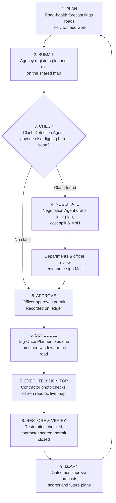

# SAMANVAY — Agentic AI for Smart Urban Infrastructure Coordination

## Project Report: Problem, Impact, Proposed Solution and Solution Architecture

| | |
|---|---|
| **Project** | SAMANVAY (समन्वय — *"coordination, harmony"*) |
| **Theme** | Smart Cities · Urban Governance · Agentic AI · Citizen Services |
| **Focus city (pilot)** | Navi Mumbai, Maharashtra, India |
| **Tagline** | *Plan together. Dig once.* |

---

## Table of Contents

1. [Executive Summary](#1-executive-summary)
2. [Introduction](#2-introduction)
3. [Problem Statement](#3-problem-statement)
4. [Impact of the Problem](#4-impact-of-the-problem)
5. [Proposed Solution — SAMANVAY](#5-proposed-solution--samanvay)
6. [Solution Architecture](#6-solution-architecture)
7. [How We Plan to Solve It](#7-how-we-plan-to-solve-it)
8. [Benefits and Expected Impact](#8-benefits-and-expected-impact)
9. [Challenges and How We Will Address Them](#9-challenges-and-how-we-will-address-them)
10. [Conclusion](#10-conclusion)
11. [Glossary](#11-glossary)
12. [References](#12-references)

---

## 1. Executive Summary

Indian city roads are cut open again and again. A road is freshly built or resurfaced. Then the gas company digs it to lay a pipeline, the telecom operator digs it for fibre, the power utility digs it for cables, and the water board digs it for a new main, often within weeks of each other. Each agency follows its own plan and timeline. None of them can see what the others are about to do.

The results are severe:
- **Public money is wasted** on digging and restoring the same stretch several times. Telecom fibre cuts alone cost India about **₹3,000 crore a year**.
- **Lives are lost.** Pothole-related crashes killed **1,856 people in 2022, 2,161 in 2023 and 2,385 in 2024**. Open, unbarricaded trenches cause further deaths. Excavation crews that don't know where gas lines run have caused pipeline fires.
- **Cities are choked.** Congestion in just four metros was estimated to cost up to **US$22 billion a year**. Dug-up roads make it worse.
- **Air quality suffers.** Road and construction dust is the **single largest source of PM10** in several Indian cities.
- **Citizens lose trust.** Residents cannot find out who dug their road, why, or when it will be fixed.

The root problem is not engineering. It is **coordination**. Cities have permission systems, but no system that brings agencies together *before* they dig, agrees on a single joint plan, holds contractors accountable for restoration, and keeps citizens informed.

**SAMANVAY** is our proposed solution: an **AI-powered coordination platform** for all agencies that dig city roads. It works like a shared "air-traffic control" for road works:

1. A **single digital map and permit window** where every agency registers planned digging.
2. **Automatic clash detection**: the system spots when two or more agencies plan to dig the same place at around the same time.
3. An **AI negotiation assistant** that drafts a fair joint plan (who digs first, combined dates, cost sharing) and a ready-to-sign agreement (MoU).
4. A **"Dig-Once" planner** that bundles all works on a road into one coordinated window.
5. **Road-health forecasting** that predicts which roads are likely to need digging soon, so work is planned before roads are rebuilt.
6. A **citizen portal** for complaints in English, Hindi or Hinglish, routed automatically to the right department, with rewards for useful reports.
7. **Contractor accountability** through performance scores, penalties and blacklisting.
8. A **tamper-proof public record** of every permit and agreement, so anyone can verify what was approved and when.

We plan to start with a **pilot in one ward of Navi Mumbai**, measure the results, and then expand city-wide and to other cities. Based on international "dig-once" evidence (cost savings of 25–33% in urban areas), SAMANVAY aims to cut road-closure days and restoration costs by at least a quarter. It also aims to make road works safer, faster and fully transparent.

---

## 2. Introduction

### 2.1 What "Samanvay" means

*Samanvay* (समन्वय) is a Sanskrit and Hindi word meaning **coordination, harmony or bringing together**. The name states the central idea of the project: most problems with city road works do not come from poor engineering. They come from different agencies **not working together**.

### 2.2 Background: a city under construction

India is in the middle of one of the largest urban infrastructure build-outs in the world:

- The **Smart Cities Mission** undertook more than **8,000 projects worth over ₹1.6 lakh crore** across 100 cities.
- **City gas distribution** companies are laying piped natural gas networks in hundreds of cities.
- Telecom operators are rolling out **5G and fibre-to-the-home**, which needs large amounts of underground cable.
- Cities like Mumbai are **concretising hundreds of kilometres of roads**. Mumbai alone has work orders for about 700 km.
- Water supply, sewerage and storm-water networks are being expanded or replaced, and power utilities are moving overhead lines underground.

Almost all of this infrastructure runs **under the same roads**. Every new pipe, cable or duct means cutting the road open. With so many agencies working at once, the chance that they collide on the same stretch keeps rising.

### 2.3 Who is involved in a typical city

| Type of agency | Examples (Navi Mumbai / Maharashtra context) |
|---|---|
| Road owner | Municipal corporation (NMMC), PWD, CIDCO, MSRDC |
| Water and sewerage | Municipal water department |
| Gas | Mahanagar Gas (MGL), Maharashtra Natural Gas (MNGL) |
| Electricity | MSEDCL, private distribution companies |
| Telecom | Jio, Airtel, BSNL, Vi and other fibre providers |
| Others | Metro rail, traffic police, storm-water drains, smart-city SPV |

A single important road can easily have **six to twelve different agencies** with a reason to dig it.

---

## 3. Problem Statement

### 3.1 The story of one road

The following example is typical of what citizens across Indian cities report:

> **Month 1:** The municipal corporation resurfaces Sector 15 Road. Residents are relieved.
> **Month 2:** The water department digs a 2.5-metre-deep trench to replace an old pipeline. Half the road is closed for 18 days.
> **Month 2, a week later:** The gas company arrives to lay a pipeline in **almost the same spot**. It did not know the water work was happening. The road is cut again for 15 days.
> **Month 3:** A telecom operator digs a narrow channel along the edge for fibre cable.
> **Month 4:** Restoration is patchy. Each agency fills only its own trench, at different levels and with different quality. Potholes appear with the first rains.
> **Month 5:** A biker falls into an unbarricaded pit. Residents complain to the ward office, which says it is the gas company's work. The gas company says the contractor is responsible. Nobody can say who will fix the road, or when.

If the water and gas works had been planned together, **one trench, one closure and one restoration** would have done the job.

### 3.2 How road digging works today

```
  Agency A plans its work ──► applies for permission ──► digs ──► restores (sometimes)
  Agency B plans its work ──► applies for permission ──► digs ──► restores (sometimes)
  Agency C plans its work ──► applies for permission ──► digs ──► restores (sometimes)
            │                         │                    │              │
     plans made alone       permission is checked    no shared view   quality rarely
     (no shared calendar)   one request at a time    of who else is   checked; blame
                            (not coordinated)        digging nearby   between agencies
```

Each agency treats its work as a separate project. The road owner approves requests one at a time and usually does not compare them against each other. Once the work starts, there is little real-time monitoring. After the work ends, restoration quality is hard to enforce.

### 3.3 Evidence from Indian cities

Our research found the same pattern across the country:

| City | What was reported |
|---|---|
| **Mumbai** | Citizens report newly concretised roads dug up within **15 days** for gas lines, then again **30 days later** for power or fibre. A citizen forum called this a "criminal waste of public money". In **March 2025**, the BMC **banned digging of newly built roads** and mandated utility ducts. It is also drafting a revised trenching policy because excavation keeps rising with the piped-gas rollout. |
| **Bengaluru** | Despite an online road-cutting system and fines of up to **₹25 lakh** for unauthorised digging, in **January 2026** the Greater Bengaluru Authority warned BWSSB, BESCOM, KPTCL and GAIL of **criminal action** over rampant cutting without permission. During one inspection, officials could not even tell the minister **which agency had dug the road**. The state has announced a **unified GIS platform** for all agencies. |
| **Pune** | Tilak Road was dug up **three days** after resurfacing. Citizens say they have asked for a "one road, one agency" scheme for **15 years**. The PMC collected about **₹50 crore a year** in excavation charges (2024-25 and 2025-26), yet activists say potholes keep coming back. |
| **Nashik** | MNGL deposited **₹392 crore** for road restoration, but disputes over who should actually repair the roads continued. The result was an action plan requiring GIS mapping of all works. |
| **Mangaluru** | A state minister publicly admitted that concrete roads were dug repeatedly for gas and water projects because agencies did not coordinate. |
| **Dharamsala** | More than **₹30 crore** was spent on a 3-km Smart City road, which a telecom firm then dug up to lay ducts that **already existed**. |
| **Goa** | Newly hot-mixed roads were dug up repeatedly, and the state had to announce that the digging department would be held responsible for repairs. |
| **Delhi** | Road-cutting permission went online in 2016 across the PWD, MCDs, the Jal Board, IGL and power and telecom companies. It digitised *permission*, but not *coordination*. |

### 3.4 Root causes

Our research points to **eight connected root causes**:

**1. Planning happens in silos.**
Each department plans its yearly works around its own budget, deadlines and priorities. There is no shared calendar of who intends to dig where and when. Two agencies can plan work on the same road a few weeks apart and never find out.

**2. Permission is not the same as coordination.**
Where online permission systems exist, they treat each request on its own: is the form complete, are the fees paid? They do not ask whether someone else is digging the same spot next month and whether the two works can be combined. A permission system **records** digging. It does not **prevent repeated** digging.

**3. Nobody has a full picture of what lies underground.**
Pipes, cables and ducts belong to different organisations, and their maps are often outdated, on paper, or not shared. This causes repeated digging, accidental damage to other utilities, and dangerous incidents such as gas leaks and fires.

**4. The restoration accountability gap.**
After digging, who restores the road, to what standard, and by when? Practice varies from city to city, and even year to year. Sometimes the utility pays a fee and the city restores the road. Sometimes the utility restores it itself. Disputes over rates and quality are common, as in Bengaluru, Pune and Nashik. Patchy restoration leads directly to potholes.

**5. Weak monitoring and contractor accountability.**
The actual digging is usually done by contractors. There is little systematic tracking of whether they dig in the permitted location, use barricades, control dust, finish on time and restore properly. Poor performers face few consequences and get hired again.

**6. Repairs are reactive, not predictive.**
Roads are often rebuilt without checking whether a pipe or cable under them is due for replacement soon. A road that is certain to need a new water main next year should not be resurfaced this year without first laying that main.

**7. Citizens are left out.**
Residents are the first to notice an abandoned trench, a missing barricade or digging in the wrong place. Yet complaints go into general helplines, often in a mix of Hindi and English. They are not linked to the specific permit or contractor, so they get lost or bounced between departments.

**8. There is no transparency, so there is no trust.**
Citizens and even officials cannot easily check who approved a dig, when, for how long and on what conditions. Without a trustworthy record, blame passes from one party to the next and corruption risks grow.

```
                     REPEATED DIGGING OF THE SAME ROAD
                                    │
   ┌──────────┬──────────┬──────────┼──────────┬──────────┬──────────┐
   │          │          │          │          │          │          │
 Silo      Permission   Unknown   Restoration  Weak      Reactive   Citizens
 planning  ≠ coord-     under-    gap          contractor repairs   unheard /
           ination      ground                 checks               no trust
```

### 3.5 Why current efforts have not solved it

Governments know about the problem and have taken steps. Each step addresses only **one part** of it:

| Existing effort | What it does well | What it leaves unsolved |
|---|---|---|
| **Call Before u Dig** (Department of Telecommunications, 2023) | Warns underground asset owners before excavation, reducing damage to telecom cables | Does not coordinate schedules, combine works, or involve citizens |
| **PM GatiShakti National Master Plan** | National map of infrastructure for big-project planning | Works at national or project level, not day-to-day ward-level road works |
| **City online permission portals** (Delhi, Bengaluru) | Digital applications and fees | Approve requests one by one; do not detect or resolve clashes |
| **Bans and fines** (Mumbai's no-dig rule, Bengaluru's fines) | Discourage careless digging | Hard to enforce without real-time visibility; do not help agencies plan *together* |
| **Utility ducts and corridors** | A long-term structural fix on new roads | Expensive, slow, and useful only where they are already built |

What is missing is a layer that **connects all of these**: one that brings every agency onto the same map, **spots conflicts automatically, helps agencies agree on a joint plan, and follows the work through to proper restoration**, with citizens able to see and report what is happening.

### 3.6 Formal problem statement

> **Urban roads in India are repeatedly excavated by multiple independent agencies because there is no shared, intelligent and enforceable system to plan, coordinate, monitor and account for underground works. This wastes public money, endangers lives, worsens congestion and pollution, disrupts essential services, and erodes public trust. A solution is needed that brings all road-cutting agencies onto one platform, detects and resolves conflicts before digging begins, plans works so that each road is dug once, holds contractors accountable for safe execution and restoration, and gives citizens a transparent view and a voice.**

---

## 4. Impact of the Problem

### 4.1 Economic impact: money dug into the ground

| Indicator | Figure | What it shows |
|---|---|---|
| Damage to telecom fibre cables during digging (India) | ~**10 lakh cuts a year**, ~**₹3,000 crore a year** lost | Uncoordinated excavation damages other agencies' assets, at a national cost |
| Excavation charges collected by a single city (Pune) | ~**₹50 crore a year** | Large sums are paid for restoration, yet roads still suffer potholes |
| Restoration deposit by one gas company (Nashik) | **₹392 crore** | The scale of restoration money at stake, and of disputes over it |
| Wasted road project (Dharamsala) | **₹30+ crore** on 3 km, dug up afterwards | Building roads without coordination destroys the investment |
| Cost of digging up a road vs. coordinated installation | About **10 times more expensive** to dig up and repair a road for new cable than to lay it during construction (US FHWA) | Coordination before construction is far cheaper |
| Savings from "dig-once" coordination | **25–33%** lower cost in urban areas (US GAO) | International evidence that coordination works |

Every repeated dig means paying again for excavation, again for restoration, again for traffic management and again for repairs to accidentally damaged utilities. Taxpayers, utility customers and citizens bear this cost.

### 4.2 Human safety: lives lost on dug-up roads

- **Pothole crashes:** Union government data shows pothole-related crash deaths rising from **1,856 in 2022** to **2,161 in 2023** and **2,385 in 2024**, more than **9,400 deaths in five years**. Patchy trench restoration is a major cause of potholes.
- **Open trenches and pits:** News reports keep describing deaths from unbarricaded excavations. Examples include a biker who died in a 15-foot drain trench in Thane (2021), a man who fell into a water-board pit in Bengaluru (2021), a pedestrian swept into an unbarricaded drainage trench in Hyderabad, and a pedestrian who died in an open manhole during drainage repair in Mumbai (2026).
- **Gas pipeline accidents:** Digging by crews who did not know where gas lines ran has caused fires and injuries:
  - Andheri, Mumbai (2025): three people suffered severe burns.
  - HSR Layout, Bengaluru: an explosion injured three.
  - Pune (2023): a fire, and gas supply cut to about 1,000 households.
  - Thiruvananthapuram (2026): a pipeline rupture.

### 4.3 Traffic and mobility

- Congestion in Delhi, Mumbai, Bengaluru and Kolkata was estimated (BCG, 2018) to cost up to **US$22 billion a year** in lost time, fuel, pollution and accidents. Bengaluru alone was estimated to lose about **₹20,000 crore a year**.
- Every road closure for digging narrows lanes, creates bottlenecks and diverts traffic onto smaller streets. When the same road is closed **three or four times a year** instead of once, the disruption multiplies.
- Emergency vehicles, buses and school transport are delayed. Pedestrians, especially elderly and disabled people, lose footpaths for weeks.

### 4.4 Environment and public health

- Studies of Delhi have estimated that **road dust contributes 36–66% of PM10** pollution. Across several Indian cities, road and soil dust make up a large share of particulate pollution (for example, about 47% in Mumbai and 57% in Pune at residential sites, per CPCB's source-apportionment studies).
- Each excavation creates dust, debris, noise and extra fuel burned by idling traffic. Repeating the same dig repeats all of this.
- Residents near dig sites report breathing problems, especially asthma patients, children and the elderly.

### 4.5 Disruption of essential services

- When one agency's excavator damages another agency's pipe or cable, **water supply, gas, electricity, internet and mobile service** can be cut for whole neighbourhoods.
- Damaged fibre affects hospitals, banks, businesses, digital payments and work-from-home users.
- Repeated repairs to damaged services trigger further digging, which keeps the cycle going.

### 4.6 Governance and public trust

- **Blame games:** When a road is left broken, the municipal body, utility and contractor each point to the others. Citizens cannot tell who is responsible.
- **Courts and protests:** Road conditions reach High Courts, RTI applications and street protests, which takes up official time.
- **Corruption risk:** Opaque permissions and restoration contracts allow inflated bills and poor-quality work.
- **Lower faith in "smart city" investment:** When a newly built road is dug up within days, citizens see wasted public money and lose faith in development projects.

### 4.7 Who is affected, and how

| Stakeholder | How they suffer today |
|---|---|
| **Citizens and commuters** | Longer travel times, unsafe roads, dust, noise, service outages, no way to get answers |
| **Pedestrians, elderly and disabled people** | Footpaths blocked, open pits, falls and injuries |
| **Shopkeepers and local businesses** | Customers cannot reach them; sales drop for weeks at a time |
| **Municipal corporation** | Pays to rebuild roads repeatedly; faces public anger and court cases |
| **Utility companies (water, gas, power, telecom)** | Slow permissions, damage to their own assets by others, high restoration charges, project delays |
| **Contractors** | Unclear rules, disputes over responsibility; good performers are not recognised |
| **Traffic police and emergency services** | Unplanned closures, diversions, delayed emergency response |
| **Environment** | More dust, emissions and construction waste |

### 4.8 The cost of doing nothing

As gas, fibre, water, power and metro networks all expand at once, **the number of excavations will keep rising**. Without coordination, every new rupee spent on roads is at risk of being dug up, and every new pipe or cable increases the chance of damaging an existing one. The problem will **grow with India's urban growth**.

---

## 5. Proposed Solution — SAMANVAY

### 5.1 Vision

> **"Every road in the city is dug only once for all the work it needs, safely, on schedule and in full view of the public."**

### 5.2 Core idea

SAMANVAY acts as an **"air-traffic control" for road works**. An airport does not let each airline decide on its own when to land. A control tower sees every plane and sequences them safely. In the same way, SAMANVAY sees every planned dig in the city, spots possible collisions, and helps agencies **agree on one combined plan before anyone picks up a shovel**.

It uses a team of **AI agents**. Each one is a specialised digital assistant with a specific job: detecting conflicts, drafting agreements, planning schedules, predicting road health, handling citizen complaints, and keeping records. The agents work together and do the routine analysis and paperwork. **Human officers stay in control** and make the final decisions.

### 5.3 Guiding principles

1. **Coordinate before digging, not after.** Prevention is cheaper than repair.
2. **One map, one source of truth.** Every agency sees the same up-to-date picture.
3. **AI assists, humans decide.** The AI drafts plans and agreements, and officers approve them.
4. **Fair to every agency.** Cost sharing and sequencing follow clear, explainable rules.
5. **Citizens are partners.** The public can see works, report problems and be rewarded for helping.
6. **Transparent by design.** Key decisions are recorded so they cannot be secretly altered.
7. **Build on what exists.** Connect to existing government systems (Call Before u Dig, GatiShakti, DigiLocker, city command centres) instead of replacing them.

### 5.4 Key capabilities

| # | Capability | What it does, in simple terms |
|---|---|---|
| 1 | **Shared map and single permit window** | Every agency submits its planned dig through one system. It marks the exact area on a map and gives the dates, depth and contractor. All works in the city appear on one live map. |
| 2 | **Clash Detection Agent** | As soon as a new dig is submitted, the system checks whether anyone else plans to dig the same area (or within about 50 metres) at an overlapping or nearby time. It rates each clash from *low* to *critical*. |
| 3 | **Negotiation Agent and joint MoU** | For each clash, the AI drafts a joint plan: combined dates, which agency digs first (usually the deepest work), cost sharing in proportion to each agency's share of the work, and how many closure days are saved. It produces a ready-to-sign **Memorandum of Understanding**. |
| 4 | **Dig-Once Planner** | Looks at all upcoming works on each road in a ward and arranges them into one coordinated sequence, so the road is opened once and restored once. |
| 5 | **Road-Health Forecasting** | Uses data such as road age, past digging, pipe and cable age, rainfall and traffic to predict which roads are likely to need digging in the next 90 days. Planners can then schedule utility work *before* resurfacing. |
| 6 | **Citizen Complaint Assistant** | Citizens report problems in English, Hindi or Hinglish (for example *"road khoda 3 hafte pehle, abhi tak theek nahi hua"*). The AI understands the complaint, sets its category and urgency, sends it to the right department, and awards **civic points** to the citizen. |
| 7 | **Contractor Accountability** | Each contractor gets a transparent **performance score (0–100)** based on on-time completion, penalties, safety violations, verified KYC and citizen complaints. Repeat offenders can be **blacklisted**. |
| 8 | **Site Compliance Checks** | Contractors upload site photos. These are checked for barricades, correct location, trench size and dust control, and citizens can add their own photos as ground truth. |
| 9 | **Tamper-Proof Public Record** | Every permit, status change and agreement is recorded on a **blockchain ledger**, so it cannot be secretly changed later. A public **"Permit Explorer"** lets anyone look up a permit and see its full history. |
| 10 | **Citizen Portal** | Shows active digs near you, expected completion dates, alternative routes around closures, a complaint form, and a civic-points leaderboard. |
| 11 | **Officer Dashboard** | Gives city officials a single view: live map, active clashes, pending approvals, complaints, contractor rankings, road-risk forecasts and AI agent activity. |

---

## 6. Solution Architecture

### 6.1 The big picture

SAMANVAY has **five layers**. Each layer has a clear job, and together they turn scattered road-work information into coordinated action.

```
┌─────────────────────────────────────────────────────────────────────────────┐
│  1. PEOPLE                                                                  │
│  Department officers · Municipal engineers · Contractors · Citizens ·       │
│  Traffic police · Auditors                                                  │
└───────────────────────────────────┬─────────────────────────────────────────┘
                                    │
┌───────────────────────────────────▼─────────────────────────────────────────┐
│  2. ACCESS LAYER — portals people use                                       │
│  Officer Dashboard │ Live Works Map │ Permit Window │ Citizen Portal │       │
│  Contractor App    │ Public Permit Explorer │ WhatsApp / SMS (planned)      │
└───────────────────────────────────┬─────────────────────────────────────────┘
                                    │
┌───────────────────────────────────▼─────────────────────────────────────────┐
│  3. INTELLIGENCE LAYER — the team of AI agents                              │
│                                                                             │
│   Clash Detection ──► Negotiation ──► Dig-Once Planner                      │
│        ▲                                     │                              │
│        │                                     ▼                              │
│   Road-Health Forecast        Complaint Assistant        Contractor Scoring │
│                                                                             │
│   Coordinator: passes work between agents, keeps humans in the loop        │
└───────────────────────────────────┬─────────────────────────────────────────┘
                                    │
┌───────────────────────────────────▼─────────────────────────────────────────┐
│  4. DATA LAYER — the city's shared memory                                   │
│  Digital map of roads & works │ Permits & schedules │ Clashes & agreements │
│  Complaints & citizen points  │ Contractor records  │ Road-health history   │
└───────────────────────────────────┬─────────────────────────────────────────┘
                                    │
┌───────────────────────────────────▼─────────────────────────────────────────┐
│  5. TRUST LAYER — tamper-proof records                                      │
│  Blockchain ledger of permits, status changes and signed agreements         │
└─────────────────────────────────────────────────────────────────────────────┘

        ◄──── CONNECTIONS TO EXISTING GOVERNMENT SYSTEMS ────►
   Call Before u Dig · PM GatiShakti map data · DigiLocker (contractor KYC) ·
   City Integrated Command & Control Centre · e-Sign · Payment gateways
```

### 6.2 What each layer does

**Layer 1: People.**
SAMANVAY serves everyone involved in road works. It is not limited to one department.

**Layer 2: Access.**
Each user group gets a simple, purpose-built interface:
- **Officers** see the city dashboard and approve plans.
- **Departments** submit works through one permit window.
- **Contractors** upload progress and site photos.
- **Citizens** use the portal (and later WhatsApp or SMS) to see works and report problems.
- **Anyone** can verify a permit through the public explorer.

**Layer 3: Intelligence.**
This is the "brain" of SAMANVAY: a team of specialised AI agents that work together (see 6.3). A coordinator passes tasks from one agent to the next. For example, once the clash agent finds a conflict, the negotiation agent drafts a plan, and the result goes to an officer for approval.

**Layer 4: Data.**
A single shared database that knows **where** (a digital map of every road and every planned trench), **when** (start and end dates), **who** (department and contractor) and **what happened** (clashes, agreements, complaints, scores, road condition history). Because everyone writes to the same place, everyone sees the same truth.

**Layer 5: Trust.**
Important events, such as a permit submitted, approved, clashed, or an agreement signed, are written to a **blockchain ledger**. Once recorded, they cannot be quietly edited or deleted. This gives auditors, courts and citizens confidence that the record is genuine. Personal citizen information is **never** stored there.

### 6.3 The AI agent team

| Agent | Role | Everyday analogy |
|---|---|---|
| **Clash Detection Agent** | Checks every new dig against all others for overlap in place and time, and rates the severity | A calendar that warns *"someone else has booked this room at the same time"* |
| **Negotiation Agent** | Drafts a fair joint plan and an MoU for clashing agencies | A neutral mediator who prepares a draft agreement for both sides |
| **Dig-Once Planner** | Arranges all works on a road into one coordinated sequence | A wedding planner arranging every vendor so the venue is set up once |
| **Road-Health Forecaster** | Predicts which roads will likely need digging soon | A doctor's check-up that flags health risks before they become emergencies |
| **Complaint Assistant** | Understands citizen complaints in any common language, sets urgency and routes them | A smart receptionist who sends each visitor to the right desk |
| **Contractor Scoring Agent** | Keeps a fair, transparent performance score for each contractor | A credit score for contractors |
| **Record Keeper** | Writes key events to the tamper-proof ledger | A notary who stamps and files important documents |

**Human in the loop:** The agents **recommend**. They do not dictate. Officers can accept, modify or reject any AI-generated plan, and every decision is recorded.

### 6.4 Connecting with existing government systems

SAMANVAY is designed to **work alongside** the systems that already exist:

| Existing system | How SAMANVAY connects |
|---|---|
| **Call Before u Dig** (DoT) | Shares planned digs so telecom and other asset owners are alerted, and pulls asset-owner contacts |
| **PM GatiShakti** | Uses its map layers (for example, existing fibre routes and pipelines) to improve clash checks |
| **DigiLocker** | Verifies contractor identity and documents |
| **City Integrated Command & Control Centre (ICCC)** | Shows SAMANVAY's live works map and alerts on the city's command-centre screens |
| **e-Sign** | Lets department heads digitally sign the AI-drafted MoUs |
| **WhatsApp / SMS** | Lets citizens complain and receive updates without installing an app |
| **Navigation and traffic systems** | Shares closures so commuters get alternative routes |

### 6.5 Built-in safeguards

- **Access control:** Each user sees and does only what their role allows. For example, only authorised officers can approve permits.
- **Privacy:** Citizen phone numbers and names are protected and used only to handle complaints and award points, in line with India's **Digital Personal Data Protection Act, 2023**.
- **Sensitive infrastructure:** Exact details of gas mains and fibre routes are shown only to authorised agencies. The public sees only the work zone and dates.
- **Fairness checks:** AI-drafted plans are checked against simple rules: dates must be realistic, and cost shares must add up to 100%.
- **Full audit trail:** Every AI recommendation and human decision is logged.

### 6.6 Technology at a glance

| Purpose | Approach |
|---|---|
| Digital map and location matching | GIS (geographic information system) with spatial database technology |
| AI reasoning and language understanding | Large language models for negotiation drafting and multilingual complaint understanding |
| Prediction | Machine-learning model trained on road and utility history |
| Tamper-proof records | Blockchain ledger with smart contracts |
| Portals | Web application for officers and citizens, with mobile and WhatsApp access planned |
| Hosting | Secure cloud hosted in India, as required for government data |

---

## 7. How We Plan to Solve It

### 7.1 The SAMANVAY journey of a road work



### 7.2 Step by step

**Step 1: Plan ahead.**
The Road-Health Forecaster looks at every road and flags those likely to need digging in the next 90 days. If the city is about to resurface a road whose water pipes are 35 years old, SAMANVAY alerts both the road and water departments so the pipe is replaced **before** the new surface goes down.

**Step 2: Submit through one window.**
Instead of separate paper or online applications, every agency registers its planned work in SAMANVAY. It marks the exact trench area on the map and adds dates, depth, purpose and contractor.

**Step 3: Automatic clash check.**
Within seconds, the Clash Detection Agent compares the new work against every other planned or ongoing work nearby. It finds overlaps in **space** (same or adjacent area) and **time** (same weeks or within a few months), and rates the severity:
- **Critical:** same spot, same week
- **High:** large overlap within a month
- **Medium:** some overlap within a few months
- **Low:** nearby works that should still talk to each other

**Step 4: AI-assisted negotiation.**
For each clash, the Negotiation Agent drafts a joint plan using clear rules:
- one combined work window
- the deeper work goes first, so the trench is opened once and shared
- costs shared fairly according to each agency's share of the work
- the fewest possible days of road closure for citizens

It produces a draft **MoU** with schedule, responsibilities, cost split, safety duties and penalties for delay.

**Step 5: Human review and approval.**
Department heads and the municipal officer review the draft, adjust it if needed, and **digitally sign** it. The permit is approved, and the approval and agreement are recorded on the tamper-proof ledger.

**Step 6: Dig-Once scheduling.**
The Dig-Once Planner places all approved works on the road into a single coordinated sequence. It can avoid sensitive periods such as the monsoon, festivals, exams or major events. Traffic police get advance notice for diversions.

**Step 7: Execution and live monitoring.**
- Contractors upload site photos, which are checked for barricades, signage, correct location and dust control.
- Citizens see the work on the public map, with expected completion dates and alternative routes.
- Citizens can report problems such as a missing barricade, wrong location or abandoned work. The Complaint Assistant routes each report to the responsible department immediately, and the citizen earns civic points.

**Step 8: Restoration and verification.**
When work finishes, restoration is checked through photos, inspection and citizen confirmation. The contractor's score is updated: rewarded for on-time, quality work, penalised for delays, violations or poor restoration. The permit is closed on the ledger.

**Step 9: Learning loop.**
Every completed work, clash outcome and complaint is fed back into the system. Forecasts get more accurate, negotiation drafts get better, and contractor scores stay current.

### 7.3 Worked example: Sector 15 Road, Vashi (Navi Mumbai)

| | **Today (without SAMANVAY)** | **With SAMANVAY** |
|---|---|---|
| Water department | Digs 1–18 Aug (2.5 m deep, 85 m²) | Registers work; clash flagged instantly |
| Gas authority | Digs 10–25 Aug in the same spot (1.8 m deep, 60 m²) | Registers work; clash flagged as **High** |
| Coordination | None; each finds out on site | AI drafts a joint plan within minutes |
| Plan | Two separate trenches, two closures | **One trench:** Water digs first (deeper), 1–12 Aug; Gas lays its pipe in the **same open trench**, 13–22 Aug |
| Cost | Each pays full excavation and restoration | Shared restoration (for example 55% Water / 45% Gas, based on work share) |
| Road closure | ~33 days in total, two disruptions | ~22 days, **one** disruption (**~11 citizen-days saved**) |
| Restoration | Patchy, two different jobs, disputes | One restoration, one responsible lead, verified before closure |
| Record | Scattered files | Signed MoU and every status change on the public ledger |
| Citizens | Confused and angry | See dates on the map, get alternative routes, can report issues |

### 7.4 Before and after at a glance

| Aspect | Today | With SAMANVAY |
|---|---|---|
| Planning | Each agency alone | Shared map and calendar for all |
| Conflict discovery | On site, after damage | Automatically, before digging |
| Resolving conflicts | Meetings, letters, months | AI-drafted plan and MoU in minutes, approved by officers |
| Road openings | Several times a year | Once, for all works |
| Underground damage | Frequent (₹3,000 crore a year to fibre alone) | Reduced through shared maps and advance alerts |
| Restoration | Disputed, patchy | One responsible party, verified |
| Contractor performance | Unknown | Public score, penalties, blacklisting |
| Citizen complaints | Lost in helplines | Understood, routed and tracked automatically, with rewards |
| Transparency | Opaque files | Tamper-proof public record |

### 7.5 Implementation plan

**Phase 1: Foundation (Months 0–2)**
- Get a **municipal mandate** (for example, a Commissioner's circular) that makes SAMANVAY the required channel for road-cutting requests in the pilot area.
- Bring together the main agencies (water, gas, power, telecom, roads and traffic police) and agree on simple common rules for clash severity, cost sharing and restoration standards.
- Load the base map of the pilot ward: roads, known utility routes and current permits.

**Phase 2: Pilot in one ward (Months 3–8)**
- Launch the permit window, clash detection, negotiation, officer dashboard and citizen portal in **one Navi Mumbai ward**.
- Train officers, agency staff and contractors.
- Measure results against the previous year: number of clashes caught, joint works agreed, closure days saved, complaints handled and restoration quality.

**Phase 3: City-wide rollout (Months 9–18)**
- Extend to all wards of the city.
- Add road-health forecasting, contractor photo checks, and WhatsApp/SMS complaints in Marathi, Hindi and English.
- Connect to Call Before u Dig, GatiShakti data, DigiLocker, e-Sign and the city command centre.

**Phase 4: Scale to other cities (Months 18+)**
- Offer SAMANVAY as a shared platform for other municipal corporations, or as a state-level system.
- Publish results and open data so other cities can learn from them.

**What we need from government and partners**
- An official mandate so all agencies participate
- Access to existing map data from agencies and GatiShakti
- A nominated nodal officer in each agency
- Agreement on common restoration standards and a cost-sharing formula

---

## 8. Benefits and Expected Impact

### 8.1 Benefits for each stakeholder

| Stakeholder | Benefits |
|---|---|
| **Citizens** | Fewer and shorter road closures; safer roads with fewer potholes and open pits; cleaner air; advance information and alternative routes; a simple way to complain and be heard; rewards for civic participation |
| **Municipal corporation** | Roads stay intact longer; lower repair spending; fewer complaints and court cases; a single view of all works; evidence-based planning |
| **Utility companies** | Faster, predictable approvals; shared trench and restoration costs; less damage to their own pipes and cables; fewer disputes |
| **Contractors** | Clear rules; fair, transparent evaluation; good performers stand out and win more work |
| **Traffic police and emergency services** | Advance notice of closures; better diversion planning; quicker emergency access |
| **State and national government** | Better value from infrastructure spending; supports Smart Cities, GatiShakti and Digital India goals; a model other cities can copy |
| **Environment** | Less dust, construction waste and idling-traffic emissions |

### 8.2 Expected outcomes (pilot targets)

| Goal | How we measure it | Target in pilot ward (12 months) |
|---|---|---|
| Catch conflicts before digging | % of clashes detected before work starts | **95% or more** |
| Combine works | % of clashes resolved through a joint plan / MoU | **60% or more** |
| Reduce disruption | Road-closure days saved vs. previous year | **25% or more** reduction |
| Reduce damage to utilities | Accidental damage incidents reported | **50% or more** reduction |
| Respond to citizens faster | Time from complaint to assignment | **Under 1 minute** (automatic) |
| Improve restoration | % of restorations verified as meeting standard | **90% or more** |
| Accountability | % of active contractors with a live score | **100%** |
| Transparency | % of permits with a public, tamper-proof record | **100%** |

### 8.3 Illustrative savings for one mid-sized city

> *These figures are planning estimates for illustration. Actual values will be measured during the pilot.*

| Item | Estimate |
|---|---|
| Road-cutting permits per year | ~2,000 |
| Permits that clash with another work | ~15% → about 300 pairs |
| Clashes converted into joint works | ~50% → about 150 joint works |
| Restoration saved per joint work | ~80 m² × ₹2,500 per m² ≈ ₹2 lakh |
| **Restoration money saved per year** | **≈ ₹3 crore** |
| **Road-closure days avoided per year** | **≈ 1,500** |
| Plus | Fewer accidents, less utility damage, less congestion and pollution (not counted above) |

Across India's 50+ large cities, the savings could reach **hundreds of crores of rupees a year**, before counting lives saved and productivity regained.

### 8.4 Broader social impact

- **Saving lives:** Fewer potholes, open trenches and gas-line strikes directly reduce road deaths and injuries.
- **Better governance:** Clear responsibility and a tamper-proof record reduce blame-shifting and corruption.
- **Citizen empowerment:** People become active partners in keeping their roads safe.
- **Sustainable cities:** Less waste, dust and emissions.
- **UN Sustainable Development Goals:** SDG 3 (road safety and health), SDG 9 (resilient infrastructure), SDG 11 (sustainable cities and communities) and SDG 16 (transparent, accountable institutions).

---

## 9. Challenges and How We Will Address Them

| Challenge | Why it matters | How we will address it |
|---|---|---|
| **Agencies may not want to participate** | Coordination only works if everyone joins | Secure an official mandate; show quick wins (faster approvals, shared costs); start with the city's own departments |
| **Incomplete maps of underground utilities** | Clash checks are only as good as the data | Start with known permits and GatiShakti data; improve the map with every new dig; ask contractors to record what they find |
| **Trust in AI-drafted agreements** | Officers must be confident in the plans | AI only drafts; humans always approve; plans follow clear, explainable rules; every decision is logged |
| **Disagreement over cost sharing** | Money is the most sensitive issue | Agree on a standard formula up front (based on trench share and depth); the AI applies it consistently |
| **Digital skills and change management** | Staff are used to paper and phone calls | Simple interfaces, training, help desk, and WhatsApp access for field staff and citizens |
| **Privacy and security** | Citizen data and critical infrastructure details are sensitive | Role-based access, DPDP Act compliance, no personal data on the public ledger, restricted utility details |
| **Sustaining the system after the pilot** | Many government pilots fade out | Embed it in the city's command centre and rules; a low-cost shared model; show measurable savings |

---

## 10. Conclusion

Repeated digging of city roads is one of the most visible failures of urban governance in India. It wastes thousands of crores of rupees, contributes to thousands of deaths every year, clogs traffic, pollutes the air, disrupts essential services and damages public trust. Our research shows the problem in city after city: Mumbai, Bengaluru, Pune, Nashik, Mangaluru, Dharamsala, Goa and Delhi. It will grow as India builds more gas, fibre, water, power and metro networks under the same roads.

The core problem is not a lack of rules or technology. It is a **lack of coordination**. Agencies plan alone, permissions are granted one by one, restoration responsibility is unclear, and citizens are left out.

**SAMANVAY** addresses this directly. It brings every agency onto **one shared map**. A team of **AI agents** detects clashes automatically, drafts fair joint plans and agreements, arranges works so each road is dug once, forecasts which roads need attention, understands citizen complaints in their own language, and keeps contractors accountable. A **tamper-proof public record** makes the whole process transparent. **Human officers stay in charge** of every decision.

Starting with a single ward in Navi Mumbai and expanding step by step, SAMANVAY aims to reduce road-closure days and restoration costs by at least a quarter, sharply cut accidental utility damage, and make road works safer and fully transparent for every citizen.

> **SAMANVAY: Plan together. Dig once.**

---

## 11. Glossary

| Term | Meaning |
|---|---|
| **Agentic AI / AI agent** | An AI assistant that carries out a specific task on its own (for example, checking for clashes) and works with other agents and humans |
| **Clash** | When two or more agencies plan to dig the same or nearby area at overlapping or close times |
| **Dig-Once** | Combining all underground works on a road into a single excavation and restoration |
| **MoU** | Memorandum of Understanding: an agreement between departments on how they will carry out joint work |
| **Restoration** | Repairing the road surface after digging |
| **GIS** | Geographic Information System: digital mapping technology |
| **Blockchain ledger** | A digital record that cannot be secretly changed once written |
| **ICCC** | Integrated Command and Control Centre, set up by smart cities to monitor city services |
| **Call Before u Dig (CBuD)** | Department of Telecommunications app that alerts asset owners before excavation |
| **PM GatiShakti** | National digital master plan for coordinated infrastructure planning |
| **DigiLocker** | Government digital document and identity verification platform |
| **DPDP Act** | Digital Personal Data Protection Act, 2023 (India's data privacy law) |
| **PM10 / PM2.5** | Fine particles in air that harm health; road and construction dust are major sources |
| **Hinglish** | Hindi written in English letters, mixed with English words |

---

## 12. References

**Repeated digging and city evidence**
- The Week / PTI — BMC bans digging of new roads (Mar 2025): https://www.theweek.in/wire-updates/national/2025/03/05/bes13-mh-roads-digging.html
- Janata Weekly — Why are people still dying on Mumbai's roads?: https://janataweekly.org/indias-richest-civic-body-world-class-neglect-why-are-people-still-dying-on-mumbais-roads/
- Together V Can — BMC to shift utilities into ducts: https://togethervcan.in/?p=5550
- Free Press Journal — Mumbai concretisation barricading: https://www.freepressjournal.in/mumbai/mumbai-road-concretisation-bmc-orders-barricading-faster-work-to-ease-traffic-chaos
- Deccan Herald — Unauthorised road cutting, GBA warns of penal action (2026): https://www.deccanherald.com/india/karnataka/bengaluru/unauthorised-road-cutting-in-bengaluru-gba-chief-warns-of-penal-action-3849968
- Deccan Herald — BBMP ₹25 lakh fine for unauthorised digging: https://www.deccanherald.com/amp/story/india%2Fkarnataka%2Fbengaluru%2Fbbmp-announces-hefty-fine-of-rs-25-lakh-for-unauthorised-road-digging-903498.html
- The News Minute — Who dug up the road? Bengaluru agencies clueless: https://www.thenewsminute.com/amp/story/karnataka/who-dug-up-the-road-bengaluru-agencies-clueless-during-krishna-byre-gowdas-inspection
- Citizen Matters — Works coordination among city agencies: https://citizenmatters.in/1652-works-coordination-city-agencies/
- BBMP — MARCS: https://site.bbmp.gov.in/departmentwebsites/BBMPIT/MARCS.html
- MyPunePulse — Tilak Road dug within 3 days: https://www.mypunepulse.com/?p=81396
- Punekar News — PMC fines L&T for unauthorised digging: https://www.punekarnews.in/pune-pmc-imposes-rs-8-77-lakh-fine-on-l-soon-citizens-can-verify-permissions-online/
- Punekar News — ₹101 crore excavation charges, roads still potholed: https://www.punekarnews.in/?p=244398
- Free Press Journal — Nashik MNGL ₹392 crore restoration: https://freepressjournal.in/pune/nashik-mngl-nmc-tighten-road-excavation-rules-392-crore-restoration-fee-gis-mapping-and-safety-measures-in-focus
- Deccan Herald — Mangaluru lack of coordination: https://www.deccanherald.com/amp/story/india%2Fkarnataka%2Flack-of-coordination-between-agencies-has-affected-works-in-mangaluru-minister-1117820.html
- The Tribune — Telecom firm digs up ₹30 crore Dharamsala road: https://www.tribuneindia.com/news/himachal/telecom-firm-digs-up-30-cr-dsala-road-to-lay-ducts-that-already-existed
- Herald Goa — Hot-mixed roads digging: https://www.heraldgoa.in/?p=460755
- Delhi Govt — Online road-cutting permission (2016): https://publicity.delhi.gov.in/publicity/permission-road-cuttingroad-digging-will-now-be-granted-online-26th-november-2016
- Nagrika — "Digging our own holes": https://nagrika.org/nagrikaspeaks/road-digging

**Restoration charges and disputes**
- Infrastructure Today — PMC road restoration charges: https://infrastructuretoday.co.in/pmc-hikes-road-restoration-charge-to-rs-2600-per-metre/
- Punekar News — MSEDCL road restoration costs: https://www.punekarnews.in/cost-surge-for-msedcl-pune-municipal-corporation-cuts-discounts-on-road-restoration/
- Punekar News — Electricity companies to pay ₹100 per metre: https://www.punekarnews.in/road-excavation-becomes-cheaper-in-pune-electricity-companies-to-pay-just-rs-100-per-meter/
- Deccan Herald — BBMP unhappy with road repair: https://www.deccanherald.com/india/karnataka/bengaluru/unhappy-road-repair-bbmp-review-2015407
- Free Press Journal — BMC: utility companies to blame for bad roads: https://www.pressreader.com/india/the-free-press-journal/20180803/282501479444440

**Safety impact**
- Siasat — Pothole-related deaths surge 53% in 5 years (9,438 killed): https://www.siasat.com/pothole-related-road-deaths-surge-53-in-5-yrs-9438-killed-nationwide-3348935/
- Factly — Fatality rate on potholed roads: https://factly.in/data-fatality-rate-in-accidents-on-potholed-roads-increased-from-0-27-in-2013-to-0-42-in-2022
- Tribune — Pothole accidents killed 5,626 (2018–2020): https://tribuneindia.com/news/accidents-caused-by-potholes-killed-5626-people-during-2018-2020-424252
- MoRTH Road Accidents in India 2022: https://indiaenvironmentportal.org.in/reports-and-documents/road-accidents-in-india-2022
- Siasat — 1.72 lakh deaths in road accidents in 2023: https://www.siasat.com/1-72-lakh-people-died-in-road-accidents-in-2023-road-ministry-report-3264450/amp/
- Hindustan Times — Biker falls into trench, dies (Thane 2021): https://www.pressreader.com/india/hindustan-times-st-mumbai/20210616/281762747206397
- Udayavani — Bengaluru biker dies after falling into pit: https://www.udayavani.com/english-news/bengaluru-biker-dies-after-falling-into-a-pit-dug-up-on-road-fir-filed
- Tribune — Hyderabad techie swept away in trench: https://m.tribuneindia.com/news/nation/hyderabad-techie-swept-away-in-trench-remains-untraced-316905
- Free Press Journal — Mumbai manhole death, FIR against contractor: https://www.freepressjournal.in/mumbai/mumbai-manhole-death-police-register-fir-against-contractor-workers-after-55-year-old-dies-in-sakinaka
- Free Press Journal — Andheri: digging punctures gas pipeline, 3 burned: https://www.freepressjournal.in/amp/mumbai/andheri-fire-uncontrolled-digging-punctures-gas-pipeline-3-suffer-severe-burns
- Pipeline Journal — GAIL pipeline explosion, Bengaluru: https://pipeline-journal.net/news/gas-leak-gail-pipeline-causes-explosion-injuring-three-people-bangalore
- Onmanorama — Road excavation ruptures gas pipeline, Thiruvananthapuram (2026): https://www.onmanorama.com/news/kerala/2026/07/14/road-excavation-ruptures-gas-pipeline-in-tvm-leak-contained.amp.html
- Asia Fire News — Pune Kharadi gas line fire (2023): https://gcoe.tus-fire.com/asia_news/?p=15652

**Economic, traffic and environmental impact**
- DoT — Call Before u Dig: https://eservices.dot.gov.in/call-before-u-dig
- Journals of India — CBuD, ₹3,000 crore annual loss: https://journalsofindia.com/call-before-u-dig-mobile-app/?print=pdf
- Quartz — Traffic jams in four Indian cities cost $22 billion a year: https://qz.com/india/1255427/traffic-jams-in-delhi-mumbai-bengaluru-and-kolkata-alone-cost-india-22-billion-a-year
- The Logical Indian — Bengaluru loses ~₹20,000 crore to traffic: https://thelogicalindian.com/bengaluru-loses-around-rs-20000-crore-due-to-traffic-hindrances-41037/
- CEEW — Delhi air pollution sources: https://www.ceew.in/publications/delhi-air-pollution-sources-and-causes
- CPCB 2011 source apportionment extracts: https://www.urbanemissions.info/wp-content/uploads/delhi19902022/2011-CPCB-Source-Apportionment-Report-Extracts.pdf
- CSE — Source apportionment analysis: https://cdn.cseindia.org/attachments/0.12136100_1560416301_Restoring-Air-Quality-through-Source-Apportionment-Analysis.pdf
- IEEE Global Policy — Dig Once (GAO 25–33% savings, FHWA): https://globalpolicy.ieee.org/wp-content/uploads/2017/10/IEEE17022.pdf
- Benton — Dig Once policy savings: https://www.benton.org/headlines/dig-once-digital-divide-solution-congress-squandered-and-policy-could-save-126-billion
- Common Ground Alliance DIRT report: https://trenchlesstechnology.com/common-ground-alliance-releases-2021-dirt-report/

**Government programmes**
- Morung Express — Smart City Mission projects: https://morungexpress.com/smart-city-mission-7741-projects-worth-rs-155386-crore-completed-323-projects-ongoing
- PIB — PM GatiShakti: https://static.pib.gov.in/WriteReadData/specificdocs/documents/2024/oct/doc20241012415101.pdf
- IBEF — GatiShakti integrated infrastructure planning: https://www.ibef.org/news/pm-gatishakti-national-master-plan-enables-integrated-and-coordinated-infrastructure-planning
